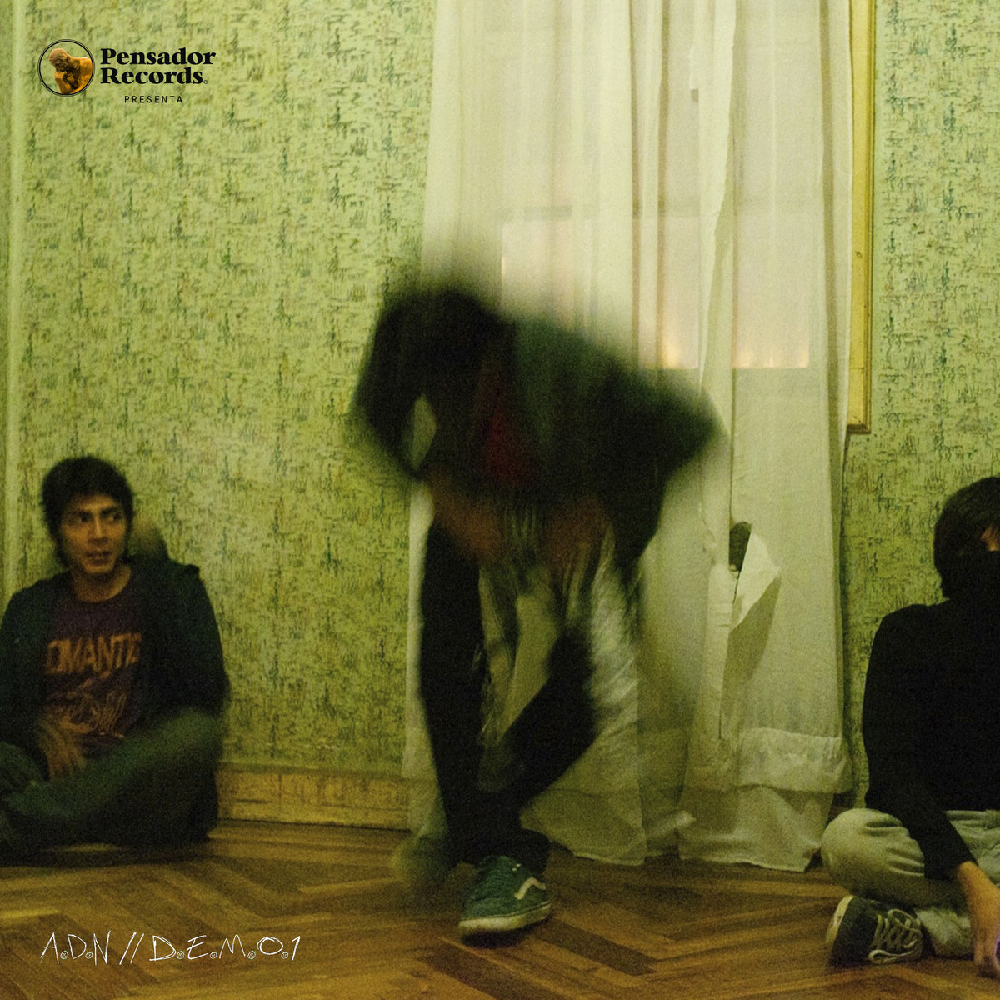

Bio

---

Amante de Niños nació en el 2013 en la ciudadela de la F.A.E en Guayaquil. Inicialmente, la banda estaba conformada por Josué Lino (bajo y voz principal), Boris Gallino (guitarra), Nelson Bodero (guitarra y segunda voz) y Antonio ‘Cheo Core’ Benenaula Vargas (batería). Tras la salida de Gallino y Bodero, Jordy Giler (guitarra y distorsiones) y Andy Rodríguez (guitarra†) entraron a ser parte de la banda trayendo consigo un gran aporte musical. Eventualmente, la formación se convirtió en un “power trio” con Josué, Jordy y Cheo.

Las influencias musicales de los integrantes de Amantes de Niños provienen de una variedad de escenarios: grindcore, hardcore, punk y diferentes corrientes de noise. Precisamente este último elemento forma parte nuclear de la identidad de la agrupación: el ruido como catalizador del malestar y la incomodidad.

La música de Amante de Niños atropella brutalmente. Un escucha desprevenido puede verse revolcado en una avalancha de rocas filosas. La voz de Lino parece tener su origen en una garra que internamente le rasga la garganta. Sus gritos compiten en velocidad y furia con las guitarras y distorsiones de Giler, en una carrera hacia la destrucción. Y debajo de todo esto, los tremores taquicárdicos de Cheo. La agresión sónica entra con sangre.

---

Albums

A.D.N//D.E.M.O.1

https://amantedenios.bandcamp.com/album/a-d-n-d-e-m-o-1

1. Pandemia 02:27

2\. Sin Fe 02:17

3\. Me Engaño 04:26

4\. Individuo 01:33

5\. Logica 02:18

acerca de

Este demo sin nombre fue el primer lanzamiento de Amante de niños que se dio en formato digital, para plataformas online.

Grabado en una sola toma dentro de las salas de Atrako Records, con la alineacion de Nelson Bodero y Jordy Giler (guitarras) ,Josue Lino (bajo) y José Antonio Benenaula (bateria).

créditos

se lanzó el 4 de octubre de 2013

Josue Lino: Bajo y voz

Nelson Bodero: 1ra Guitarra y voz

Jordy Giler: 2a Guitarra y efectos prefabricados

José Antonio Benenaula: Bateria

Portada de disco: Lucia Silva

Letra: Josue Lino

Compositores: Lino, Bodero, Benenaula

licencia

todos los derechos reservados

